# DevXchange

**The marketplace for production-ready software.**

> Don't just buy code. Know what you are buying.

DevXchange is a developer-first marketplace for source code, SaaS projects, web and mobile applications, websites, AI projects, APIs, templates and scripts. The product is designed around five practical promises: **trust, verified code, fair seller economics, transparent licensing and real versioning.**

## v1.0.0 architecture

- **Frontend:** Next.js static export, TypeScript and Tailwind CSS, deployed to GitHub Pages through GitHub Actions.
- **Base path:** `/DevXchange` for this repository deployment. Public URLs are generated with the repository base path.
- **Backend:** Supabase Postgres, Auth, Storage, Row Level Security and Edge Functions.
- **Privileged logic:** Edge Functions only. GitHub Pages cannot run a server.
- **Payments:** a provider interface with Stripe and Razorpay adapters behind Edge Functions. An order is never marked paid without a verified provider webhook.
- **Catalog:** real Supabase data only. If credentials or catalog data are unavailable, the public build shows an honest empty state.
- **Secrets:** only the Supabase publishable/anon key may reach the browser. The service-role key is restricted to server-side catalog/build tasks and is checked against build output.

## Local setup

1. Install Node.js 20.20.2 and npm 10.8.2 or a compatible Node 20 release.
2. Clone this repository.
3. Copy `.env.example` to `.env.local`.
4. Set `NEXT_PUBLIC_SUPABASE_URL` and `NEXT_PUBLIC_SUPABASE_PUBLISHABLE_KEY`.
5. Run `npm ci`.
6. Run `npm run dev`.
7. Open the local URL printed by Next.js.

The public application works with an empty catalog. It does not ship invented listings, reviews, sales or user counts.

## Supabase

Apply the SQL migrations in `supabase/migrations/` in filename order. Configure the Auth redirect URLs for the GitHub Pages base path, create the documented Storage buckets, and deploy the Edge Functions under `supabase/functions/`.

Required production configuration is documented in `docs/setup.md` and `docs/security.md`.

## GitHub Pages

The production workflow is `.github/workflows/deploy.yml` and uses `actions/configure-pages`, `actions/upload-pages-artifact` and `actions/deploy-pages`. The workflow publishes `apps/web/out` and does not use a branch-based Pages build.

In **Repository → Settings → Pages → Build and deployment → Source**, select **GitHub Actions**. Do this once if the repository is still configured for a branch/folder source.

No `CNAME` file is committed until a custom domain is actually configured.

## Trust model

Verification levels are evidence levels, not marketing grades:

0. Unverified
1. Listing Verified
2. Build Verified
3. Deployment Verified
4. Security Reviewed
5. DevXchange Certified

Recorded checks include archive integrity, file hash fingerprint, secret-pattern scan, README presence, dependency manifest and declared license. A check that has not run is **Not yet checked**. A badge cannot be purchased.

## Marketplace scope

v1 covers public discovery, categories, technology landing pages, product pages, seller onboarding and submission, versioning, admin review, structured reviews, buyer dashboards, favorites, support tickets, standard licensing, infringement reports, order creation and signed-expiring download authorization.

## Founder

DevXchange was founded by **Syed Ali Hasan Moosavi**, Founder and Managing Director of SAYANJALI NEXUS PRIVATE LIMITED, Hyderabad, India. His work spans AI products, blockchain infrastructure, enterprise SaaS, cybersecurity/OSINT, automation and open-source tooling.

GitHub: https://github.com/SHalimoosavi

## Why DevXchange exists

Today almost every builder ships websites, apps and software with AI help, and has tools to check them for vulnerabilities. But when it comes to selling, there is no simple trusted place to do it. DevXchange exists so builders can list finished software and new members can buy and start with zero code, knowing what they get.

## Quality gate

The CI workflow runs `npm ci`, typecheck, lint, unit tests, static build and a privileged-secret output guard. Pages deployment is separate and publishes the same static export through the official Pages deployment actions.

Playwright smoke coverage, Supabase-backed integration tests, payment-provider webhooks and Lighthouse require external services and credentials. They must be run against the configured deployment before those checks can truthfully be reported as green.

## Known issues

- **External service verification:** Supabase SMTP, Auth redirect configuration, payment credentials/webhooks and real buyer/seller test accounts are external configuration and are not fabricated by this repository.
- **Marketplace inventory:** the production catalog is intentionally empty until real sellers and approved listings exist.
- **Browser/E2E payment tests:** payment success cannot be tested without configured provider keys and webhook endpoints.

## Documentation

- `docs/architecture.md` — system boundaries and data flow
- `docs/setup.md` — platform-neutral setup and Supabase configuration
- `docs/security.md` — RLS, storage, downloads and secret handling
- `docs/seo.md` — sitemap, robots, JSON-LD, AEO/GEO and webmaster verification
- `docs/licensing.md` — Personal, Commercial, Extended and Enterprise terms
- `docs/api-contract.md` — public/client-to-Edge Function contract
- `docs/market-research.md` — marketplace pain points and product decisions

## License

See `LICENSE`.
